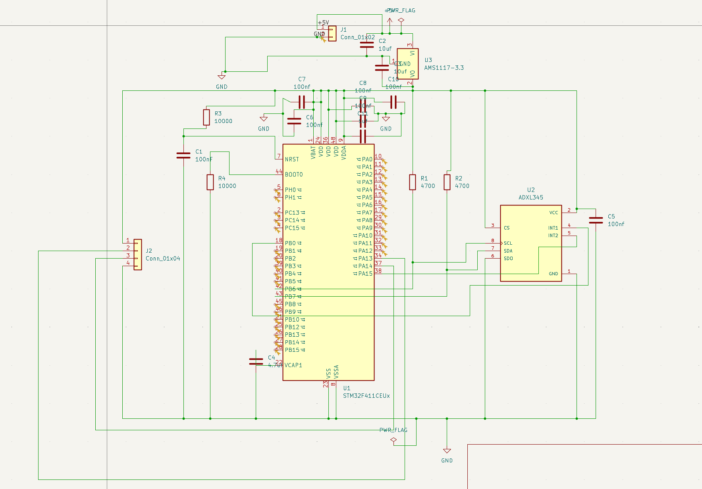
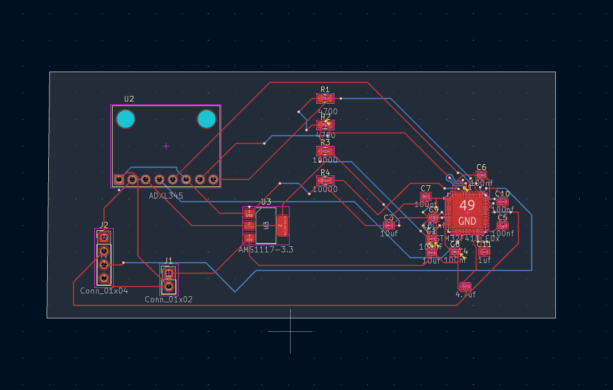
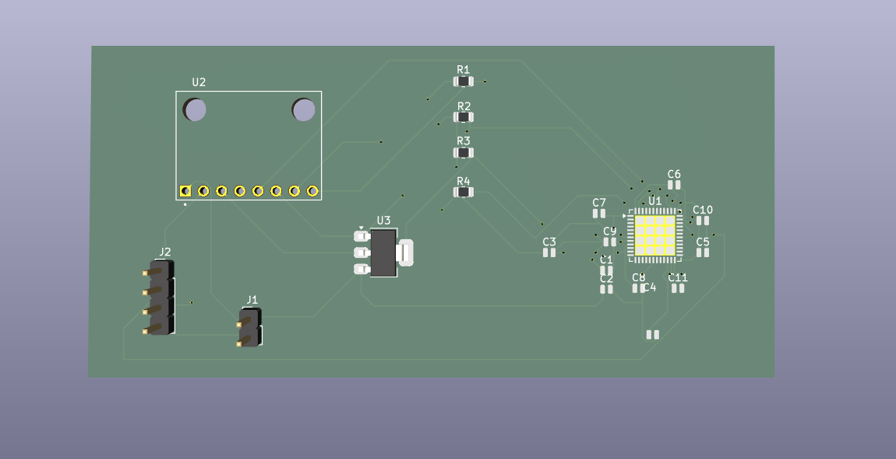

# STM32-ADXL345 Carrier Board

A custom PCB integrating an STM32F411 (Black Pill) with an ADXL345 accelerometer over I2C, including onboard power regulation. Designed in KiCad as a hardware extension of my [bare-metal STM32 driver work](https://github.com/KrishChalana/stm32-bare-metal-drivers).

**Status:** Design complete, ERC- and DRC-clean, fully routed with power input and SWD programming headers. Design files only — not yet fabricated.

## Overview

This board takes a 5V  input, regulates it down to 3.3V, and powers both the STM32F411 and an ADXL345 accelerometer connected over I2C. It's built as a companion to my register-level (no-HAL) firmware drivers, moving the same STM32 + ADXL345 setup from breadboard prototyping to an integrated PCB.

## Features

- On-board 5V power input header (J1), regulated down to 3.3V via an AMS1117-3.3 LDO
- On-board SWD programming/debug header (J2) for flashing and debugging via ST-Link — breaks out 3.3V, SWDIO (PA13), SWCLK (PA14), and GND
- STM32F411 to ADXL345 communication over I2C, with CS tied high to fix I2C mode and SDO tied to set the device address
- Full STM32F411 support circuitry: reset network (NRST), boot-mode selection (BOOT0), and the core-voltage decoupling capacitor on VCAP1
- ADXL345 interrupt pins (INT1/INT2) broken out to spare GPIOs (PB0, PA15) for future interrupt-driven sampling
- Complete decoupling strategy across all power pins

## Design decisions

- **I2C only, not SPI:** the ADXL345 supports both I2C and SPI on the same pins (pin-selectable via CS). This board is scoped to I2C to keep the first PCB design focused; I've implemented and tested both I2C and SPI drivers for this sensor separately in firmware on breadboard hardware.
- **Interrupt pins routed to general-purpose GPIOs**, chosen specifically to avoid conflicts with the Black Pill's fixed hardware functions (USB, SWD debug, UART, boot select).

## Bill of materials

| Ref | Part | Value / Package |
|---|---|---|
| U1 | STM32F411CEUx | LQFP48 (Black Pill) |
| U2 | ADXL345 | LGA-14 |
| U3 | AMS1117-3.3 | SOT-223 |
| J1 | Power input header (5V, GND) | 1x02, 2.54mm |
| J2 | SWD programming header (3.3V, SWDIO, SWCLK, GND) | 1x04, 2.54mm |
| R1, R2 | I2C pull-ups | 4.7kΩ |
| R3, R4 | NRST / BOOT0 | 10kΩ |
| C1 | NRST debounce | 100nF |
| C2 | LDO input | 10µF |
| C10 | LDO output | 100nF |
| C4 | VCAP1 (core regulator) | 4.7µF |
| C5 | ADXL345 VCC decoupling | 100nF |
| C6–C9 | STM32 VDD decoupling | 100nF each |
| C11 | VDDA bulk | 1µF |

## Repo contents

- KiCad schematic (.kicad_sch)
- KiCad PCB layout (.kicad_pcb)
- `renders/` — schematic, routed PCB, 3D render, and DRC report screenshots

## Screenshots

### Schematic

### Routed PCB

### 3D Render

## Related

- [STM32 Bare-Metal Drivers](https://github.com/KrishChalana/stm32-bare-metal-drivers) — register-level GPIO, UART, timers, ADC
- [ADXL345 I2C/SPI Driver](#) — sensor driver used with this board
